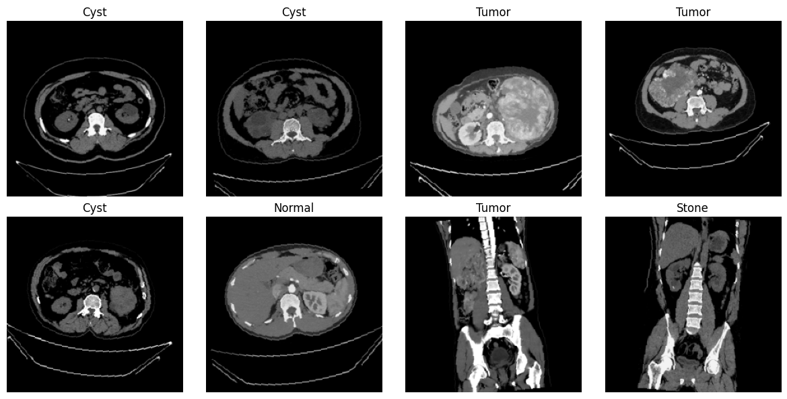
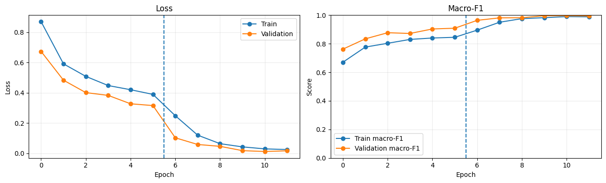
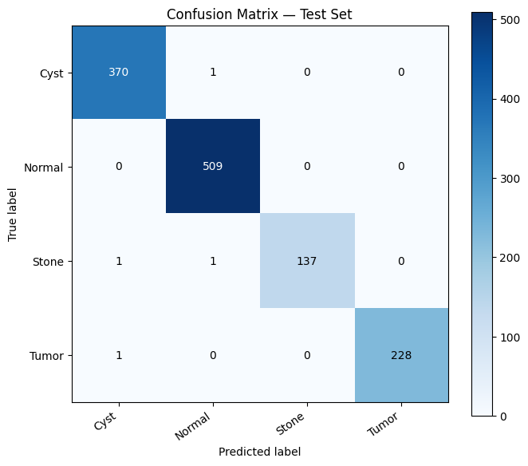
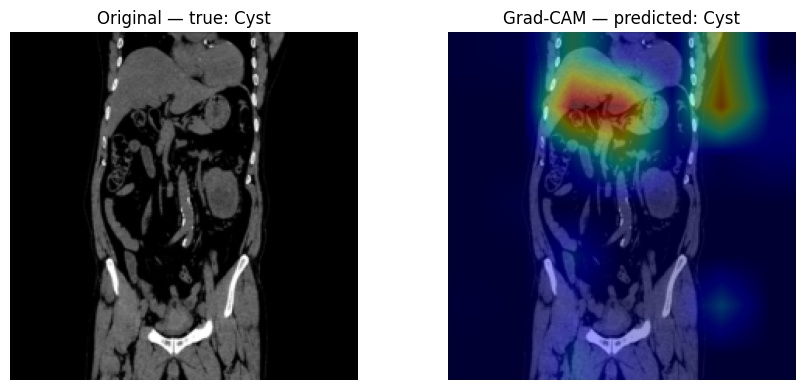
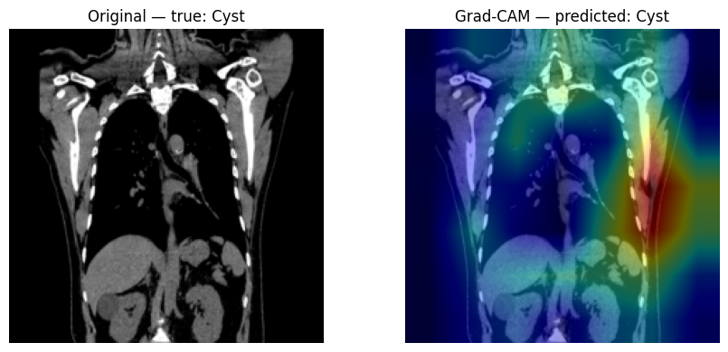
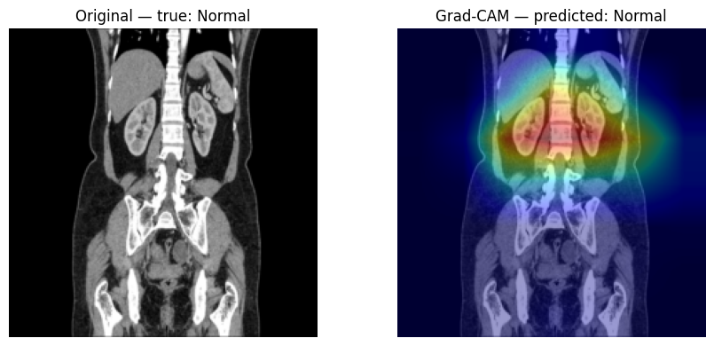
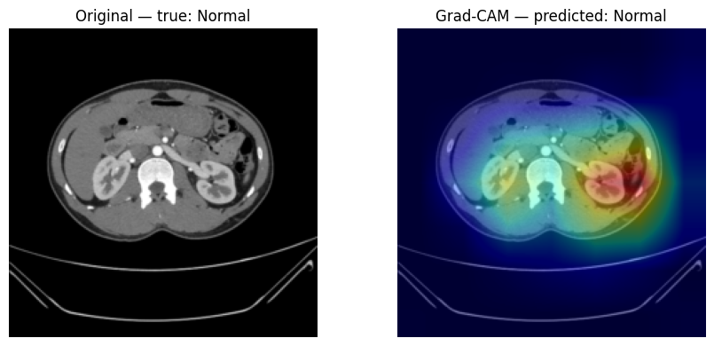

# Kidney CT Image Classification with ResNet50 and Grad-CAM

A PyTorch transfer-learning project for classifying kidney CT images into four categories: **Cyst, Normal, Stone, and Tumor**. The notebook includes a two-phase ResNet50 training pipeline, test-set evaluation, a confusion matrix, and Grad-CAM visualizations.

> **Research / educational prototype only. Not a medical device or diagnostic tool.** The model has not been clinically validated and must not be used to make medical decisions.

## Project overview

This project treats kidney CT image classification as a four-class image-recognition task. It uses an ImageNet-pretrained ResNet50 backbone and a custom classification head. Training is performed in two phases: first the backbone is frozen while the classifier head is trained, then `layer4` and the classifier are fine-tuned.

The notebook also reports per-class metrics and provides visual checks of the training examples, learning curves, test confusion matrix, and Grad-CAM explanations.

## Dataset

The notebook expects the following folder structure, which it automatically searches for under Kaggle's `/kaggle/input` directory:

```text
Split_Images/
├── train/
│   ├── Cyst/
│   ├── Normal/
│   ├── Stone/
│   └── Tumor/
├── val/
│   ├── Cyst/
│   ├── Normal/
│   ├── Stone/
│   └── Tumor/
└── test/
    ├── Cyst/
    ├── Normal/
    ├── Stone/
    └── Tumor/
```

Dataset used in the recorded notebook run: [Kidney Stone Datasets on Kaggle](https://www.kaggle.com/datasets/iamiqbalshigri/kidney-stone-datasets).

### Class distribution

The counts below are printed by the notebook from the loaded `ImageFolder` datasets.

| Split | Cyst | Normal | Stone | Tumor | Total |
|---|---:|---:|---:|---:|---:|
| Train | 2,596 | 3,553 | 963 | 1,598 | **8,710** |
| Validation | 741 | 1,015 | 275 | 456 | **2,487** |
| Test | 371 | 509 | 139 | 229 | **1,248** |
| **Total** | **3,708** | **5,077** | **1,377** | **2,283** | **12,445** |

The dataset is imbalanced, so the notebook computes inverse-frequency class weights from the training split and uses weighted cross-entropy loss. The table describes image counts, not patient counts.

## Method

### Preprocessing and augmentation

- Convert each CT image to three-channel grayscale to match the pretrained ResNet50 input.
- Resize images to `224 × 224` pixels.
- Normalize using ImageNet mean and standard deviation.
- Apply training-only augmentation: random rotation up to ±7° and brightness/contrast jitter (`0.08`).
- Do not apply horizontal flipping.
- Apply only grayscale conversion, resizing, tensor conversion, and normalization to validation and test images.

### Model and training configuration

| Setting | Notebook configuration |
|---|---|
| Backbone | ResNet50, ImageNet `IMAGENET1K_V2` weights |
| Classification head | Dropout (`p=0.35`) + linear layer (2,048 → 4) |
| Input size | 224 × 224 |
| Batch size | 32 |
| Optimizer | AdamW |
| Phase 1 learning rate | `1e-3` (classifier head; backbone frozen) |
| Phase 2 learning rate | `1e-5` (`layer4` and classifier unfrozen) |
| Weight decay | `1e-4` |
| Loss | Weighted cross-entropy |
| Learning-rate scheduler | ReduceLROnPlateau (factor `0.5`, patience `2`) |
| Early-stopping patience | 3 epochs based on validation macro-F1 |
| Maximum epochs | 6 head-training + 6 fine-tuning |
| Random seed | 42 |
| Mixed precision | Enabled when CUDA is available |

## Training sample images

The following eight images are the training batch visualization saved in the notebook output. They are example images, not a complete representation of the dataset.



## Training and validation curves

The plots show loss and macro-F1 across the 12 recorded epochs. The dashed vertical line marks the transition after six frozen-backbone epochs; fine-tuning starts at epoch 7.



## Test-set results

The notebook's recorded test-set evaluation contains **1,248 images**.

| Metric | Test result |
|---|---:|
| Accuracy | **0.9968 (99.68%)** |
| Macro precision | 0.9977 |
| Macro recall | 0.9946 |
| Macro-F1 | **0.9961 (99.61%)** |
| Macro ROC-AUC (one-vs-rest) | **1.0000** |

### Per-class classification report

| Class | Precision | Recall | F1-score | Support |
|---|---:|---:|---:|---:|
| Cyst | 0.9946 | 0.9973 | 0.9960 | 371 |
| Normal | 0.9961 | 1.0000 | 0.9980 | 509 |
| Stone | 1.0000 | 0.9856 | 0.9928 | 139 |
| Tumor | 1.0000 | 0.9956 | 0.9978 | 229 |
| **Macro average** | **0.9977** | **0.9946** | **0.9961** | **1,248** |

These are the results recorded in the uploaded notebook. They are not evidence of clinical performance or external generalization.

## Confusion matrix

The confusion matrix is calculated on the held-out test split. Rows represent true labels and columns represent predicted labels.



| True label / Predicted label | Cyst | Normal | Stone | Tumor |
|---|---:|---:|---:|---:|
| Cyst | 370 | 1 | 0 | 0 |
| Normal | 0 | 509 | 0 | 0 |
| Stone | 1 | 1 | 137 | 0 |
| Tumor | 1 | 0 | 0 | 228 |

## Grad-CAM visualizations

Grad-CAM is computed from the final convolutional block (`model.layer4[-1]`) of ResNet50. The four examples below are the four test images selected by the notebook during its recorded run. The titles show the true and predicted classes; all four displayed examples were classified correctly.

<table>
  <tr>
    <td align="center" width="50%"><strong>Example 1 — True: Cyst | Predicted: Cyst</strong><br></td>
    <td align="center" width="50%"><strong>Example 2 — True: Cyst | Predicted: Cyst</strong><br></td>
  </tr>
  <tr>
    <td align="center" width="50%"><strong>Example 3 — True: Normal | Predicted: Normal</strong><br></td>
    <td align="center" width="50%"><strong>Example 4 — True: Normal | Predicted: Normal</strong><br></td>
  </tr>
</table>

The heatmaps are qualitative illustrations. They show where the model's gradients emphasize image features for a prediction; they do **not** prove that the model is using clinically valid anatomy or that the prediction is correct. Some activation is also visible outside the immediate kidney regions, so the maps should be interpreted cautiously.

## How to run the notebook

This notebook is configured for **Kaggle Notebooks**.

1. Open `kidney_classification_pytorch.ipynb` in Kaggle.
2. Add the [Kidney Stone Datasets](https://www.kaggle.com/datasets/iamiqbalshigri/kidney-stone-datasets) dataset as notebook input.
3. In notebook settings, select a GPU accelerator. The recorded run used a Tesla T4 GPU.
4. Run the notebook cells from top to bottom. The notebook searches `/kaggle/input` for `Split_Images` and its `train`, `val`, and `test` folders.
5. The trained model and evaluation files are written to `/kaggle/working`.

### Main output files

- `kidney_resnet50_classifier.pth` — final model checkpoint.
- `training_history.csv` — training and validation metrics per epoch.
- `test_class_metrics.csv` — per-class precision, recall, F1, and support.
- `test_confusion_matrix.png` — test confusion matrix.
- `kidney_project_outputs.zip` — package of the model checkpoint and principal evaluation outputs.

The notebook includes an output-packaging cell that archives only the selected artifacts, avoiding the recursive self-inclusion problem from the earlier version.

## Repository structure

```text
kidney-ct-classification/
├── README.md
├── kidney_classification_pytorch.ipynb
└── assets/
    ├── training-samples.png
    ├── training-validation-curves.png
    ├── confusion-matrix.png
    ├── gradcam-example-1.png
    ├── gradcam-example-2.png
    ├── gradcam-example-3.png
    └── gradcam-example-4.png
```

## Limitations and ethical considerations

- **Not for diagnosis:** This is an academic/educational prototype, not a medical device. It must not guide diagnosis, treatment, or patient care.
- **Patient-level separation is unverified:** The notebook reads pre-existing train/validation/test folders. It does not inspect patient identifiers or establish that slices from the same patient are confined to a single split. Potential patient-level leakage therefore cannot be ruled out.
- **No external validation:** The reported metrics come from this dataset's test split only. Performance on data from other hospitals, scanners, acquisition protocols, or populations is unknown.
- **2D image classification:** The model processes individual 2D images and does not use full 3D CT volumes or broader clinical context.
- **Class imbalance remains relevant:** Weighted loss helps account for unequal class counts but does not eliminate possible class-specific bias.
- **Grad-CAM is not proof of explainability:** Attention maps are qualitative diagnostics, not evidence that the model learned medically meaningful features.
- **No radiologist validation:** The notebook does not document a radiologist-led review of labels, predictions, or heatmaps.

Any future clinical investigation would require verified patient-level splits, independent external validation, expert-reviewed annotations, subgroup analysis, and prospective clinical evaluation.

## Future work

- Verify patient-level provenance and rebuild the split if required.
- Perform repeated runs or cross-validation and report variation across seeds.
- Evaluate on an independent external dataset.
- Add radiologist review of false predictions and Grad-CAM maps.
- Investigate volumetric or multi-slice models that use 3D CT context.

## Author

**Muhammad Iqbal** — Hazara University  
Independent project exploring PyTorch, transfer learning, and medical-image classification.
